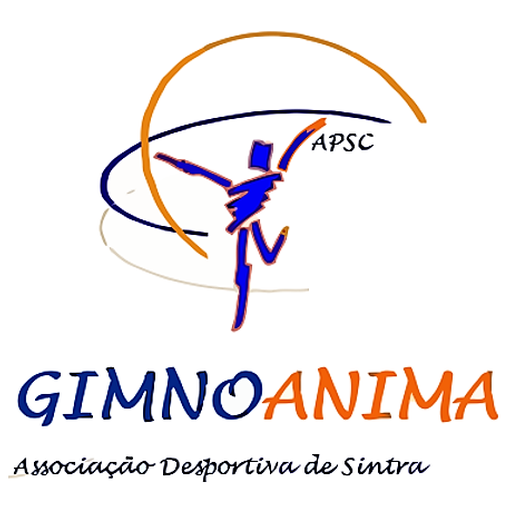

# Gimnoanima

### Treinos, objetivos, progresso e presenças — sempre à mão.

---

## O que é

A **Gimnoanima** é a app da equipa técnica para o dia a dia dos treinos, pensada para o telemóvel.

- 📅 **Plano de treino** de cada dia, por classe, com **modelos** reutilizáveis e cópia do plano para outras datas
- 📝 **Notas por treino** (o que correu bem, material, lesões…)
- 🎭 **Eventos do calendário** (sarau, competições, reuniões, dias sem treino)
- 🚩 **Objetivos** de cada classe e o que falta para os atingir
- 📊 **Progresso** de cada atleta, objetivo a objetivo, com **gráfico de evolução** ao longo da época
- 📄 **Relatório de progresso em PDF** por atleta e **Excel** do progresso da classe
- 👥 **Atletas e grupos**, com contacto do encarregado de educação (ligar / WhatsApp)
- ✅ **Presenças**, treinos realizados e **resumo mensal** (presenças, justificações e faltas por dia)
- 🔄 Várias **classes**, cada uma com os seus dias de treino

## 📲 Instalar no telemóvel

- **Android (Chrome):** menu ⋮ → *Adicionar ao ecrã principal*
- **iPhone (Safari):** partilhar ⬆️ → *Adicionar ao ecrã principal*

## 🔒 Acesso

A app pede uma password de acesso. Os planos, atletas e presenças **só ficam visíveis a quem estiver ligado à app com o token da equipa técnica** — nada disto está neste repositório.

---

Feito com 🧡 para a Gimnoanima · Sintra

